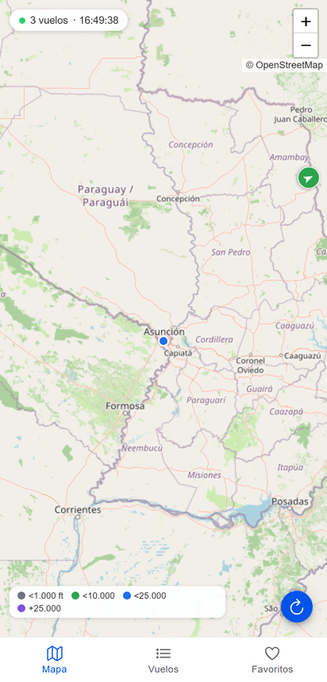
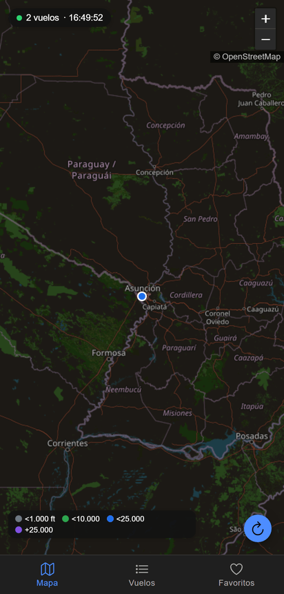
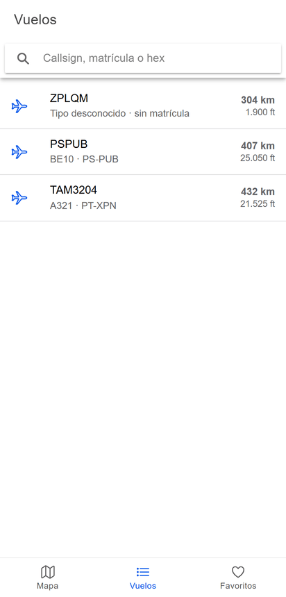
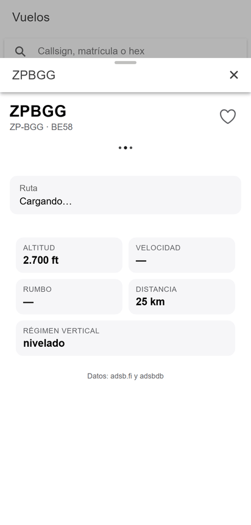
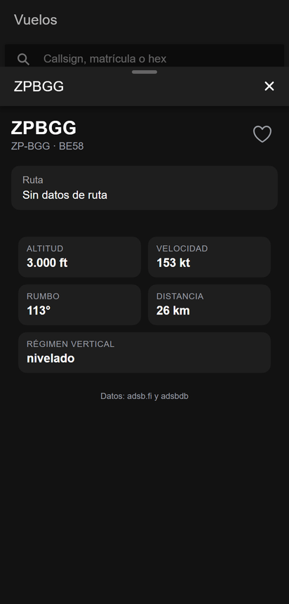

# Radar Vuelos

App móvil que muestra en un mapa los aviones que están volando cerca, en tiempo
real. Cada avión se puede tocar para ver su aerolínea, ruta, tipo de aeronave,
altitud y velocidad. También se pueden buscar y guardar en favoritos.

Hecha con **Ionic + Angular** y empaquetada con **Capacitor**. Los datos salen de
**adsb.fi** (posiciones en vivo) y **adsbdb** (rutas y aerolíneas). Las requests
se hacen con **CapacitorHttp**, así que no necesita backend ni sufre problemas de
CORS en el celular. El mapa usa **Leaflet** con tiles de OpenStreetMap.

## Integrantes

- Luis Calabro

## Capturas

| Mapa | Mapa (oscuro) | Vuelos |
|:---:|:---:|:---:|
|  |  |  |

| Detalle | Detalle (oscuro) | Favoritos |
|:---:|:---:|:---:|
|  |  |  |

## Funcionalidades

- Mapa en vivo con aviones reales (posición, rumbo y altitud), refresco cada 10 s.
  El color del avión indica la altitud.
- Lista de vuelos cercanos ordenada por distancia, con buscador por callsign,
  matrícula o código hex.
- Detalle del vuelo con aerolínea, ruta (origen → destino) y tipo de avión.
- Favoritos guardados en el dispositivo.
- Último listado guardado, para abrir la app aunque no haya conexión.
- Modo claro/oscuro según el sistema.

## Pestañas

| Pestaña | Ícono | Qué muestra |
|---|---|---|
| Mapa | `map-outline` | Aviones en vivo sobre el mapa |
| Vuelos | `list-outline` | Lista con buscador y pull-to-refresh |
| Favoritos | `heart-outline` | Vuelos guardados, se borran deslizando |

## Fuente de datos (JSON)

| API | Para qué | URL |
|---|---|---|
| [adsb.fi](https://github.com/adsbfi/opendata) | Posiciones en vivo | `https://opendata.adsb.fi/api/v3` |
| [adsb.lol](https://api.adsb.lol) | Respaldo si adsb.fi falla | `https://api.adsb.lol/v2` |
| [adsbdb](https://www.adsbdb.com) | Ruta y datos de la aeronave | `https://api.adsbdb.com/v0` |

Las URLs están en `src/environments/environment.ts` y `environment.prod.ts`.

## Componentes de Ionic usados

`ion-tabs`/`ion-tab-bar`, `ion-list`, `ion-item`, `ion-item-sliding`, `ion-label`,
`ion-searchbar`, `ion-refresher`, `ion-fab`, `ion-modal` (detalle del vuelo),
`ion-grid`, `ion-button`, `ion-icon`, `ion-note`, `ion-spinner` y
`ion-skeleton-text` (indicadores de carga).

## Estructura

```
src/app/
├── models/         interfaces (Flight, FlightRoute, ...)
├── services/       AdsbService, FlightsService, FavoritesService, ...
├── utils/          cálculo de distancias y formatos
├── pages/
│   ├── mapa/
│   ├── vuelos/
│   ├── favoritos/
│   └── flight-detail/   (modal)
└── tabs/
```

## Stack

- Ionic 9 + Angular 22
- Capacitor 8 (`CapacitorHttp`, `Preferences`, `Geolocation`, `Haptics`)
- Leaflet + OpenStreetMap
- Vitest para los tests

## Requisitos

- Node.js 20+
- Ionic CLI (`npm install -g @ionic/cli`)
- Android Studio + JDK 21 (para compilar el APK)

## Correr en el navegador

```bash
npm install
ionic serve
```

En modo web las requests pasan por el proxy de desarrollo (`proxy.conf.json`),
porque adsb.fi no manda cabeceras CORS.

## Tests y lint

```bash
npm test -- --watch=false
npm run lint
```

## Descargar el APK

El APK de debug está en la sección
[Releases](https://github.com/LuisDefv/TP_Programacion_6/releases) del repositorio.

## Compilar el APK

```bash
ionic build
npx cap sync android
cd android
./gradlew assembleDebug
```

El APK queda en `android/app/build/outputs/apk/debug/app-debug.apk`.

Para instalarlo en un celular conectado por USB:

```bash
adb install -r app-debug.apk
```

La app pide permiso de ubicación para centrar el mapa. Si se rechaza, arranca en
Asunción.

## Atribuciones

- Datos ADS-B: [adsb.fi](https://adsb.fi) (ODbL 1.0)
- Rutas y aerolíneas: [adsbdb](https://www.adsbdb.com)
- Mapa: [OpenStreetMap](https://www.openstreetmap.org)
